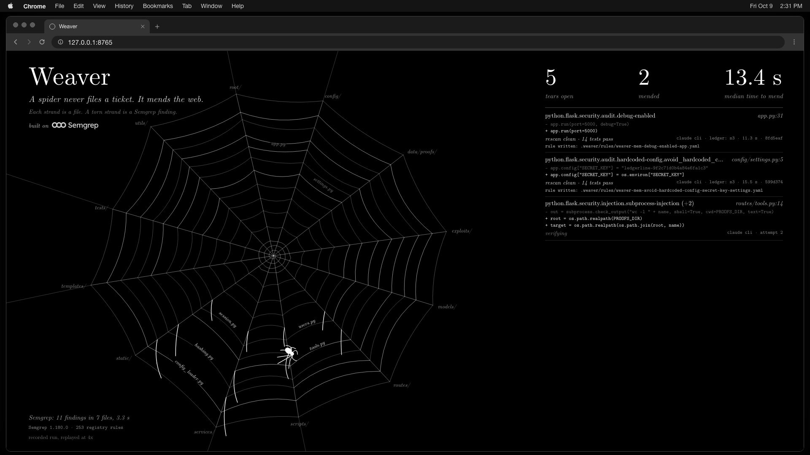
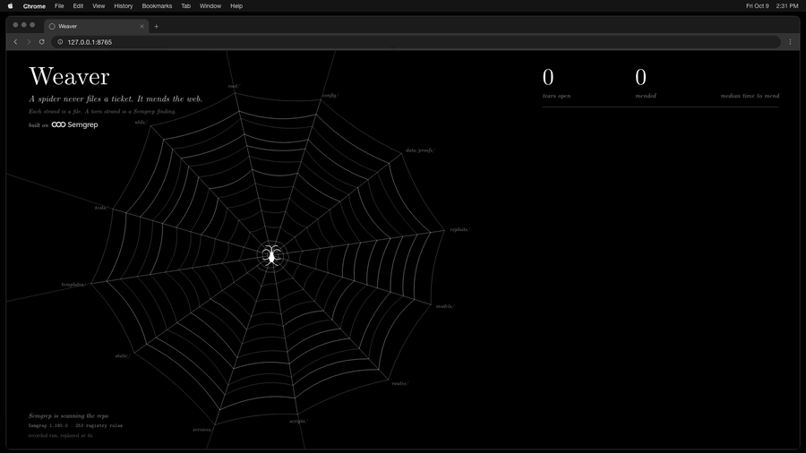
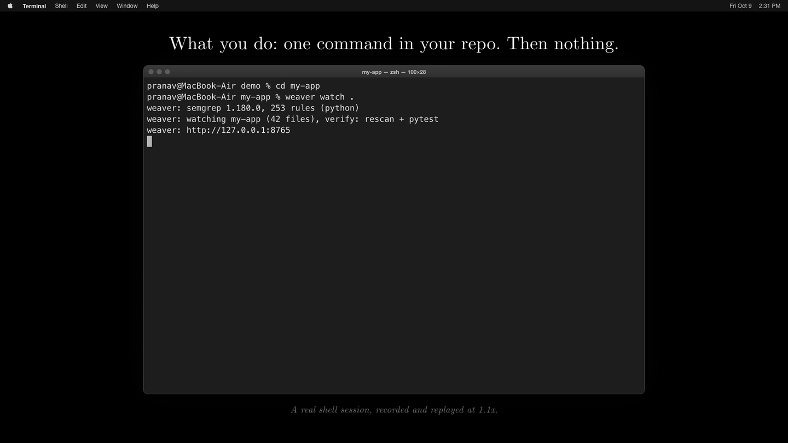
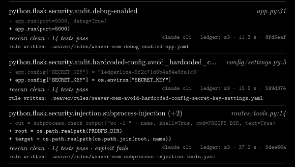
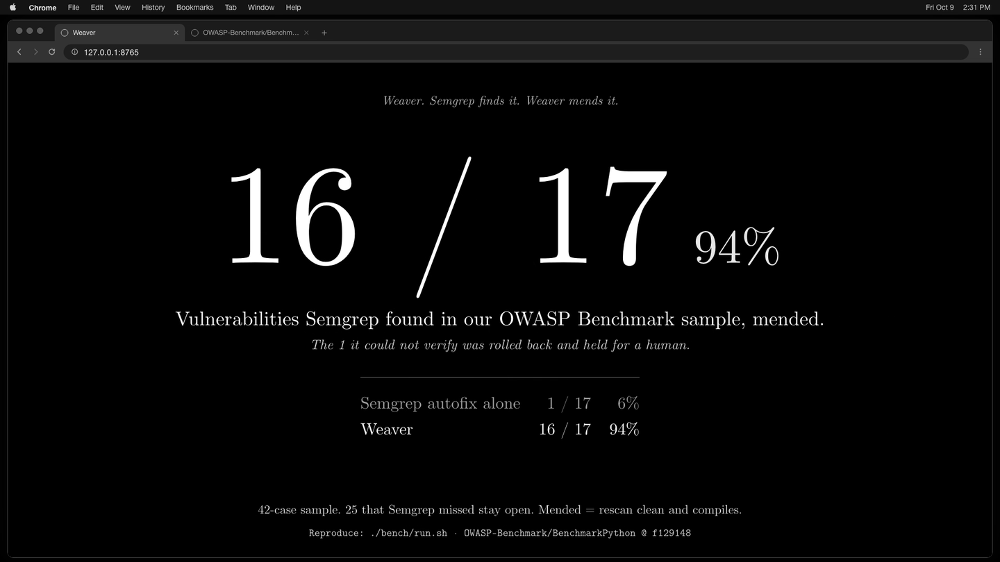
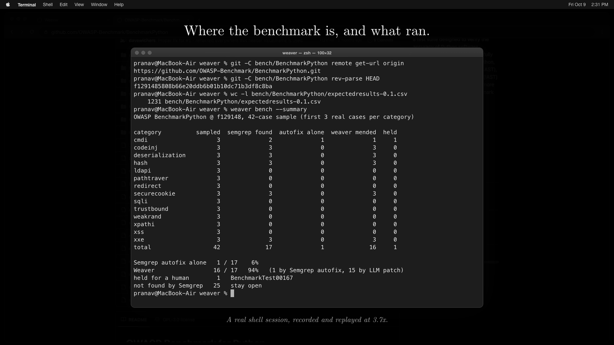

# Weaver

*A spider never files a ticket. It mends the web.*

Built on [Semgrep](https://github.com/semgrep/semgrep).



Full demo, 58.5 seconds: [demo/weaver-demo-60s.mp4](demo/weaver-demo-60s.mp4) (silent, 1080p). The previous 54 second cut is [demo/weaver-demo-60s-v5.mp4](demo/weaver-demo-60s-v5.mp4). The earlier 45 second cut is [demo/weaver-demo-45s.mp4](demo/weaver-demo-45s.mp4).

## A real run on a real project

The demo runs Weaver on [isso](https://github.com/isso-comments/isso), an open-source comment server with 5.3k GitHub stars, pinned at commit `413d447`.

| | |
|---|---|
| Semgrep findings in the repo (253 registry rules) | 25 |
| Real, mended by Weaver | 3, all in `isso/migrate.py` (lines 15, 85, 207: XML import dumps parsed with `xml.etree`) |
| Held for a human | 0 |
| Skipped by hand as false positives | 22 in 7 files |
| Verified by | Semgrep rescan clean, file compiles. isso's test suite was not run. |
| Scan time | 3.9 s |
| Finding to verified commit | 36.1 s (Semgrep autofix tried first and rolled back, then an LLM patch) |
| `weaver watch` to pull request opened | 81 s |
| Pull request | [PranavAchar01/isso#1](https://github.com/PranavAchar01/isso/pull/1), opened inside a fork. Nothing was sent upstream. |

One more line in that pull request, adding `defusedxml` to `pyproject.toml`, was written by hand and is marked so.
The session is recorded in `demo/real.cast.json`, Weaver's event log in `demo/real-run.jsonl`, the times in `demo/real-times.json`; `demo/record_real.py` is the script that ran it.

## What it is

Weaver watches a git repository and fixes what Semgrep finds in it, without being asked.
Every file is a strand in an orb web; a Semgrep finding tears the strand, and a spider walks over, patches it and plucks it to check the fix holds.
A fix is committed only if it passes every check. A fix that fails is rolled back and held for a human.

## What you do

One command in your repo. Then nothing.

```
cd my-app
weaver watch .
```



## How it works

1. **Find.** Semgrep scans the repo with registry rules (253 for Python), again on every new commit or edit.
2. **Fix.** Semgrep's own autofix goes first. A language model writes the patch only when there is no autofix or it fails the checks.
3. **Verify.** Semgrep rescans the file and the repo's tests run. Pass: commit. Fail: roll back, retry up to 3 times, then hold.
4. **Remember.** After each verified mend Weaver writes a new Semgrep rule for that code shape into `.weaver/rules/`, kept only if Semgrep confirms it matches the old code and not the fix.



Each ledger line shows the rule, the diff, the checks, what wrote the fix, the commit, and the rule Weaver wrote afterwards.

## Benchmark

Code we did not write: a fixed 42-case sample of the [OWASP Benchmark for Python](https://github.com/OWASP-Benchmark/BenchmarkPython) at commit `f129148` (the first 3 real-vulnerability cases in each of the 14 categories). It is a sample, not the full benchmark score.

| On the 17 cases where Semgrep found the vulnerability | Fixed | |
|---|---|---|
| Semgrep autofix alone | 1 / 17 | 6% |
| Weaver | 16 / 17 | 94% |

- Semgrep did not find the vulnerability in 25 of the 42 cases. Those stay open. Weaver cannot mend what the scanner does not find.
- The 1 case Weaver could not verify (BenchmarkTest00167) was rolled back and held.
- "Mended" here means the Semgrep rescan is clean and the file compiles. These cases have no tests, so it is not test-verified.
- An earlier run that used the language model only got 17 / 17. The table shows the engine that ships. We did not re-run it to get the case back.
- Semgrep autofix alone is the only comparison we ran.



Reproduce, or print the saved numbers:

```
./bench/run.sh
weaver bench --summary
```



Case ids, both runs and raw results: [bench/README.md](bench/README.md).

## Quick start

Needs `uv`, `semgrep` (`uv tool install semgrep`, no login) and the Claude Code CLI (`claude`) on the path.

```
git clone https://github.com/PranavAchar01/weaver && cd weaver
uv sync
export PATH="$PWD/.venv/bin:$PATH"

cd /path/to/your/repo
weaver watch .
```

It prints three lines and opens on http://127.0.0.1:8765:

```
weaver: semgrep 1.180.0, 253 rules (python)
weaver: watching my-app (42 files), verify: rescan + pytest
weaver: http://127.0.0.1:8765
```

Tests are found automatically (pytest, or `npm test`). With no tests it says "verify: rescan + compile only" and does that.
To try it on the bundled demo app: `./run.sh`, then `./demo/introduce.sh` to land a bad commit and `./demo/reset.sh` to start over.
AWS is optional: with credentials in `~/.config/weaver/aws.env`, every verified mend is also written to a private S3 bucket.

## Honest limits

- Only Python has been tested. JavaScript and TypeScript are wired to Semgrep registry packs and `npm test`, but that path has not been run.
- The demo app is small and its vulnerabilities were planted by us. The benchmark above is the check on code we did not write.
- The video is a replay of one real recorded run at 4x. The terminal sessions in it are real recordings too, with their replay speed shown on screen. The window frames around them are drawn, not screen-recorded.
- In the recorded run all 8 fixes were written by the language model. Semgrep's autofix was tried on two findings and did not pass.
- Amazon Bedrock is supported and tried first, but the AWS account was pending verification on the day, so Bedrock wrote no patch. Every patch came from Claude through the CLI.
- A clean rescan proves the rule no longer matches. It is not proof the code is safe. Tests and exploit checks add confidence only where they exist.
- The rules Weaver writes are checked by Semgrep, not reviewed by a person.
- Local only, no auth. Do not expose the port.

The full list and how each stage works: [docs/DETAILS.md](docs/DETAILS.md).

## Built with

- [Semgrep](https://github.com/semgrep/semgrep) 1.180.0: detection, autofix, verification and the written rules. Weaver is not affiliated with or endorsed by Semgrep.
- Amazon S3: the ledger of verified mends.
- Claude, through the Claude Code CLI: patches and rule drafts.
- Amazon Bedrock: supported, not used in the recorded run.
- Guild AI: an optional reviewer agent (`guild/weaver-review/agent.ts`) that signs off on each patch before the commit, called from `weaver/guild.py`. Off unless `~/.config/weaver/guild.env` is set. Not used in the recorded run or the benchmark.
- xterm.js, FastAPI, and Computer Modern for the type.

Built for the tokens& Cyberdefense Hackathon, 2026-10-09.
